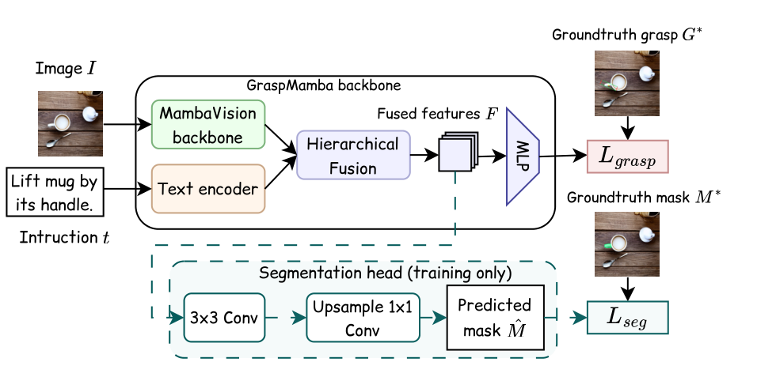

# GraspMambaTS: Language-Driven Grasp Detection with Auxiliary Target Segmentation

This is an extension of [GraspMamba](https://github.com/Eric-nguyen1402/Grasp_Mamba) that jointly learns language-driven grasp prediction and auxiliary target segmentation. Target-mask supervision encourages the shared vision-language features to distinguish the instructed region from surrounding objects. The segmentation branch is used during training and bypassed during grasp inference, preserving the original grasp prediction path.


## Table of contents

1. [Installation](#installation)
2. [Datasets](#datasets)
3. [Method](#method)
4. [Training](#training)
5. [Testing](#testing)
6. [Acknowledgement](#acknowledgement)

## Installation

- Create and activate a virtual environment with Python 3.11:

```bash
python3.11 -m venv .venv
source .venv/bin/activate
python -m pip install --upgrade pip setuptools wheel packaging ninja
```

- Install CUDA-enabled PyTorch first (CUDA 12.4 profile):

```bash
python -m pip install torch==2.6.0 torchvision==0.21.0 --index-url https://download.pytorch.org/whl/cu124
```

- Install all remaining dependencies from the single requirements file:

```bash
python -m pip install --no-build-isolation -r requirements.txt
```

This includes `mamba-ssm==2.2.5` and `causal-conv1d==1.7.0`. PyTorch is installed first because the CUDA extensions need it during installation. Source builds also require a compatible CUDA toolkit (`nvcc`).

## Datasets

The Grasp-Anything datasets can be accessed via [this link](https://airvlab.github.io/grasp-anything/docs/download/).

For language-driven part grasp detection, use **Grasp-Anything++** annotations with the `grasp-anywhere` loader. The expected directory structure is:

```text
data/
├── grasp-anything/
│   ├── image/
│   └── scene_description/
└── grasp-anything-pp/
    ├── grasp_label_positive/
    ├── grasp_instructions/
    └── part_mask/
```

`--dataset-path` points to `grasp-anything`, while `--add-file-path` points to `grasp-anything-pp`. Part masks are required when segmentation is enabled. Keep the official split files under `split/grasp-anything++/` in the repository.


## Method



GraspMambaTS adds a lightweight segmentation head to GraspMamba's shared image-text features: `Conv 3x3 + ReLU -> Conv 1x1 -> Bilinear Upsampling`. The head learns the instructed part mask during training and is skipped during grasp inference. The text encoder remains frozen.

```text
L_seg   = BCEWithLogits + lambda_dice * DiceLoss
L_total = L_grasp + lambda_seg * L_seg
```

## Training

We use GraspMambaTS with the original GraspMamba grasp branch. Enable the auxiliary head with `--segmentation`; omit this flag to train the GraspMamba baseline. Pass dataset paths and training parameters directly to [train_network.py](train_network.py). 
For example, to train the baseline using Grasp-Anything++ instructions:

```python
!python train_network.py \
    --use-depth 0 \
    --dataset grasp-anywhere \
    --dataset-path data/grasp-anything \
    --add-file-path data/grasp-anything-pp \
    --text-source instruction \
    --batch-size 8 \
    --epochs 50 \
    --batches-per-epoch 1000 \
    --lr 0.0001 \
    --description baseline_instruction
```

To train with the auxiliary part segmentation loss, add `--segmentation`:

```python
!python train_network.py \
    --use-depth 0 \
    --dataset grasp-anywhere \
    --dataset-path data/grasp-anything \
    --add-file-path data/grasp-anything-pp \
    --text-source instruction \
    --segmentation \
    --lambda-seg 0.5 \
    --lambda-dice 1.0 \
    --description segmentation_instruction
```

The total loss is `grasp_loss + lambda_seg * (BCEWithLogits + lambda_dice * DiceLoss)`. Use `--lambda-dice 0` to disable the Dice contribution. Omit `--segmentation` to run the baseline.

The default pretrained backbones are `nvidia/MambaVision-L-1K` and `google/siglip-base-patch16-224`. Override them using `--vision-model` and `--text-model`; each accepts a Hugging Face model ID or a local model directory. For CLIP ViT-B/32, add:

```bash
--text-model openai/clip-vit-base-patch32
```

## Testing

To evaluate a baseline checkpoint on the official seen test split:

```python
!python evaluate_test.py \
    --dataset grasp-anywhere \
    --dataset-path data/grasp-anything \
    --add-file-path data/grasp-anything-pp \
    --model-path "logs/<timestamp>_<description>/<checkpoint>.pt" \
    --text-source instruction \
    --eval-split test_seen \
    --iou-threshold 0.25
```

Replace `--eval-split test_seen` with `--eval-split test_unseen` to evaluate the official unseen test split. Use the same input size, vision/text model settings and text source as during training. Add `--segmentation` when loading a checkpoint trained with the segmentation head.

The reported grasp accuracy is the fraction of samples with a successful grasp: IoU must exceed the selected threshold (default 0.25), and the angle difference must be at most 30 degrees. Test evaluation uses five grasp candidates. The legacy `--seen 1` setting selects the train-seen pool for this loader, so use `--eval-split` explicitly for held-out testing.

To evaluate retained checkpoints on both seen and unseen test splits:

```python
!python evaluate_checkpoints.py \
    --logs-dir logs \
    --dataset-path data/grasp-anything \
    --add-file-path data/grasp-anything-pp \
    --text-source instruction
```


## Acknowledgement

Our codebase is based on [GraspMamba](https://github.com/Eric-nguyen1402/Grasp_Mamba). We thank the original authors for releasing their code. GraspMamba also builds on [LGD](https://github.com/Fsoft-AIC/LGD) and [MambaVision](https://github.com/NVlabs/MambaVision). Please cite the original GraspMamba paper when using this code:

```bibtex
@misc{nguyen2024graspmambamambabasedlanguagedrivengrasp,
      title={GraspMamba: A Mamba-based Language-driven Grasp Detection Framework with Hierarchical Feature Learning},
      author={Huy Hoang Nguyen and An Vuong and Anh Nguyen and Ian Reid and Minh Nhat Vu},
      year={2024},
      eprint={2409.14403},
      archivePrefix={arXiv},
      primaryClass={cs.RO},
      url={https://arxiv.org/abs/2409.14403},
}
```
